# Risa AI Pilot: Initial Data Results

**Role:** Data Analyst. Built the Metabase funnel dashboard and ran the analysis end to end.  
**Tools (visible in the screenshots):** Metabase, Redshift (`dwh_bronze`, Datalake)  
**Date of data:** 6 May 2026 (first day of the pilot)  
**Sample size:** 11 conversations, so everything below is directional, not statistical.  

## Context

Risa is Ringkas's AI sales agent. It talks to home-loan prospects in chat, runs simulations, and walks them through registration (collect info, create account, verify OTP, T&C and consent), after which it asks for their KTP.

For the pilot, 6 links to Risa were broadcast, one per campaign: Mandiri_Early, Mandiri_Mid, Mandiri_Late, Cimb_Early, Cimb_Mid and Cimb_Late. The goal was to find out whether people would talk to the AI at all, and where they would drop off. The initial target reply rate was only **5%**.

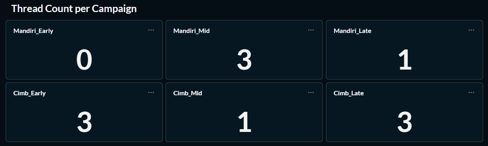

## Headline results

Within 1 day of broadcasting, **11 conversations** were created.

| Metric | Result | Note |
|---|---|---|
| Threads started | 11 | |
| Replied | 8 (**72.7%**) | Target was 5% |
| Reached registration | 3 (**27.3%**) | High against that 5% baseline |
| Transactions created | 0 | Should have been 2 (see below) |
| KTP submitted | 0 | |

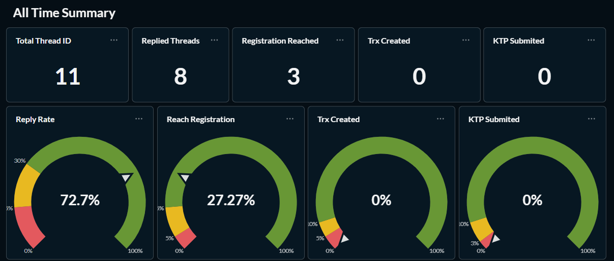

## Where users drop

Most of the drop is between **conversation start** and **registration started** (11 to 3). Once users enter registration, conversion is strong: 3 collected info, then 2 each created an account, verified the OTP and accepted the T&C (consent). Those 2 consented users then dropped when asked for their KTP.

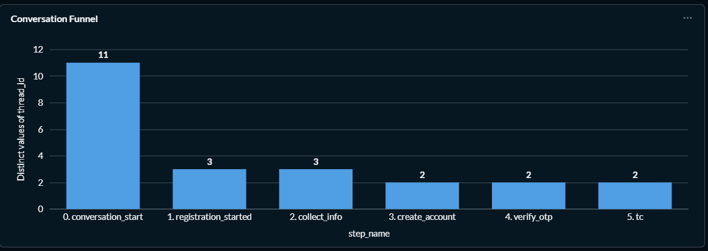

### Why the 8 non-registrants left

Of the 11 users, 8 never reached registration. To see why they dropped, I categorised the first human message (all 11 threads) and the last AI message (the 8 non-registrants).

| First human message (all 11 threads) | Count |
|---|---|
| Simulation inquiry | 6 |
| Promo and product benefits | 2 |
| "Apa saja yang perlu disiapkan" (what do I need to prepare?) | 2 |
| Custom question | 1 |

| Last AI message before drop (8 non-registrants) | Count |
|---|---|
| Simulation result | 4 |
| Asked for initial plafond and tenor | 3 |
| General document help | 1 |

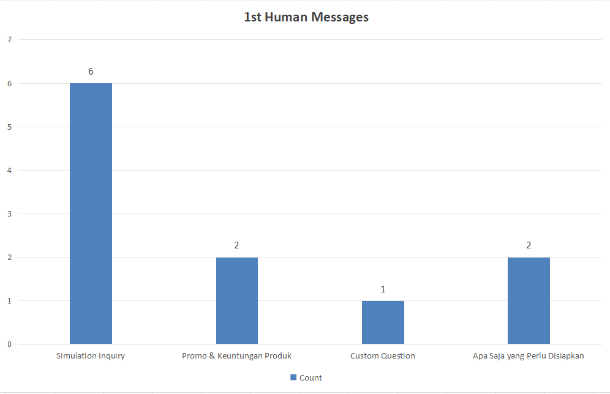
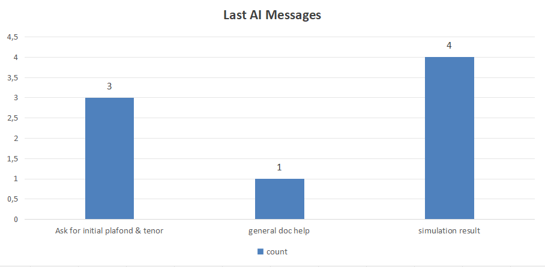

Most users open by asking for a **simulation**. Those who never registered left either right after seeing the result (4) or when asked for plafond and tenor (3). 3 of the 8 dropped on the very first turn: 2 after the plafond and tenor question and 1 after general document help.

**Interpretation (hypotheses, not tested):**
1. The simulation may not satisfy them, or they were only curious how the numbers would play out.
2. They are curious but hesitant to give detailed information to an AI.

## Engagement is better than the funnel suggests

Setting the journey aside and looking only at continuity, **8 of 11** threads had multiple turns. The average thread had about **6 turns**, so users were engaged even when they never registered.

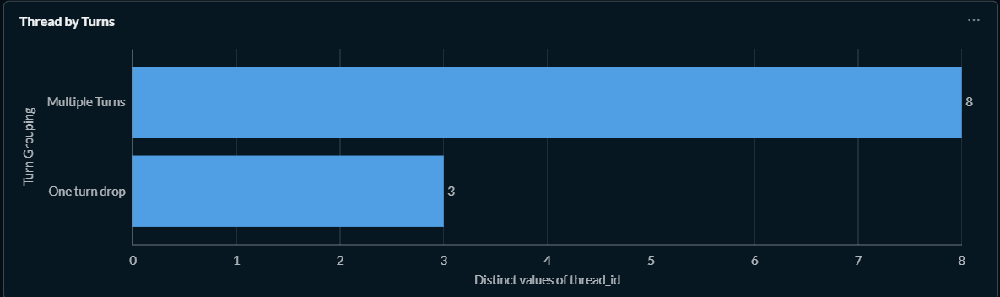
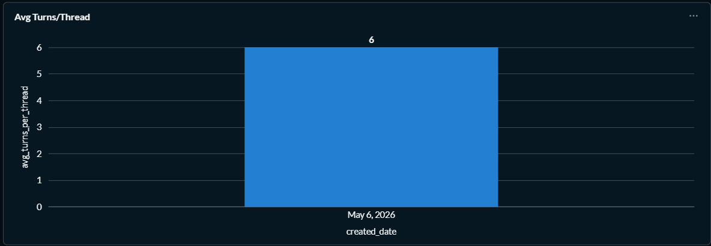

## Finding: transactions were not being created

The funnel shows 2 users reached the consent step, so each should have a new transaction.

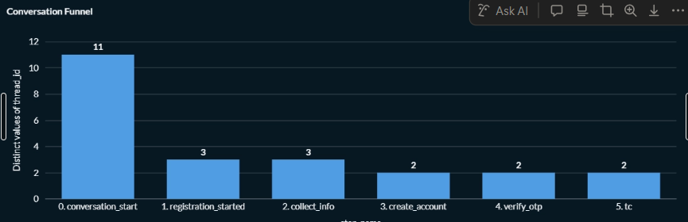

The dashboard shows none:

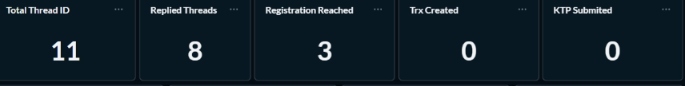

Digging into the bronze thread table, the two consented threads (created 6 May 2026) both exist, and the `E6:transaction_created` event in the second thread's values carries an **empty** `transaction_code`:

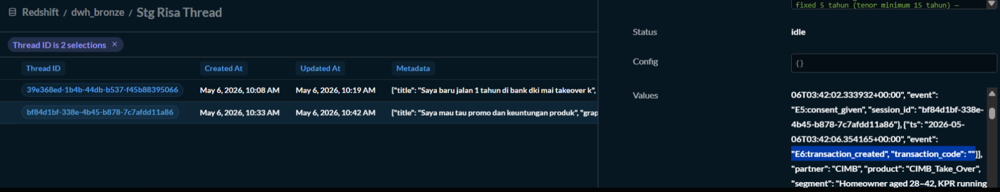

Searching the transactions fact table for those two customers returned only their **old 2025 transactions** (created 31 Oct 2025 and 20 Jan 2025), with nothing created on 6 May 2026:

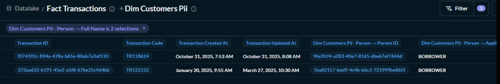

**Conclusion:** two consented users should have had new transactions, and the pipeline from Risa's event to the transaction record is broken. The thread-level transaction code is blank and no new row exists in the fact table.

## Takeaways

- **Reply rate is not the problem.** 72.7% against a 5% target means prospects are willing to talk to Risa (on a sample of 11).
- **The leak is between conversation start and starting registration** (11 to 3). Simulation requests are the largest group among openers.
- **Measurement was incomplete.** The Risa-to-transaction handoff did not record transactions for the two consented users, so conversion past consent could not be measured.

